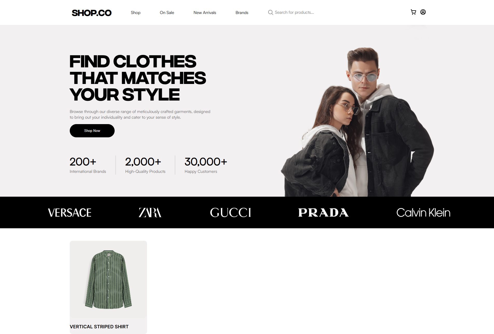
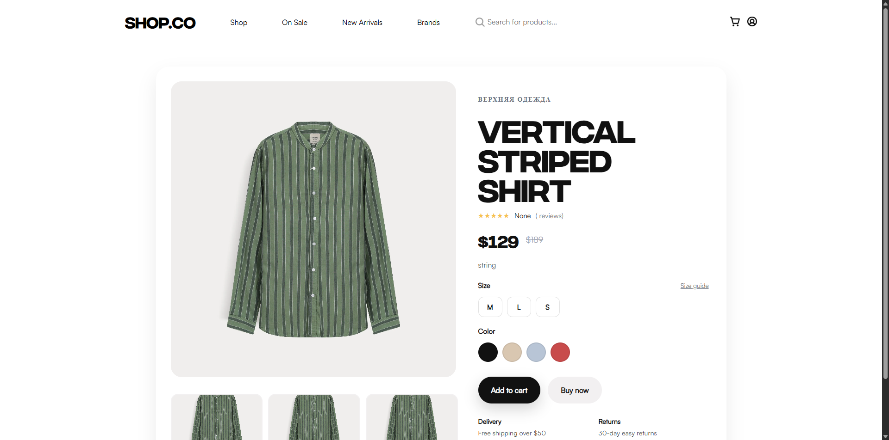
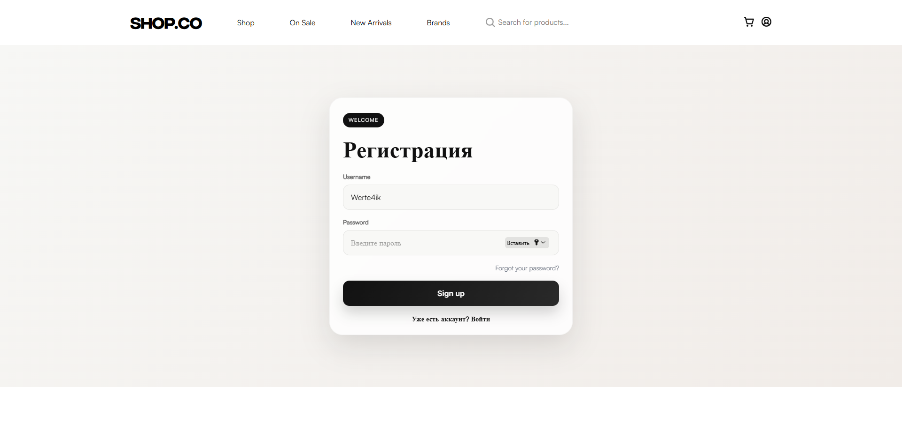

# ClothesStore

Учебный интернет-магазин одежды: интерфейс на React и Vite, API на FastAPI, база данных SQLite.

## Скриншоты

### Главная страница



### Карточка товара



### Страница входа



## Требования

- Node.js и npm
- Python 3.10 или новее

## Запуск локально

### Backend

В PowerShell из корня проекта:

```powershell
cd .\ClotheStore
py -m venv .venv
.\.venv\Scripts\Activate.ps1
python -m pip install fastapi uvicorn sqlalchemy python-multipart
python -m uvicorn main:app --reload
```

API будет доступно по адресу `http://127.0.0.1:8000`. Интерактивная документация:
`http://127.0.0.1:8000/docs`.

SQLite-файл `database.db` создаётся в текущей рабочей директории при запуске API.
Если база уже существует, приложение использует её.

### Frontend

Откройте второй терминал в корне проекта:

```powershell
npm install
npm run dev
```

Vite выведет адрес сайта, обычно `http://localhost:5173`.

Для production-сборки выполните `npm run build`; результат появится в `dist`.

## Основные API-маршруты

| Метод | Путь | Назначение |
|---|---|---|
| `POST` | `/userAdd` | Регистрация пользователя |
| `POST` | `/users/find` | Авторизация |
| `POST` | `/userToken` | Поиск пользователя по токену |
| `GET` | `/usersAll` | Получение списка пользователей |
| `POST` | `/Img/Add` | Создание карточки с изображением |
| `GET` | `/post/allposts` | Получение списка карточек |
| `GET` | `/Posts/{postId}` | Получение изображения и данных карточки |
| `GET` | `/Img/{postId}` | Получение изображения |
| `PATCH` | `/posts/{postid}` | Увеличение счётчика просмотров |
| `DELETE` | `/del/post` | Удаление карточки |
| `POST` | `/admin/add` | Назначение пользователя администратором |

Точные схемы запросов и ответов доступны в Swagger UI по адресу `/docs`.

## Публикация

Публикация только содержимого `dist` не поднимет API. Перед размещением проекта в интернете
нужно развернуть backend на сервере и настроить frontend на публичный адрес API: сейчас запросы
из React-кода направлены на `http://127.0.0.1:8000`. В backend также нужно добавить домен
опубликованного сайта в список разрешённых CORS-origin в `ClotheStore/main.py`.

SQLite-файл создаётся локально и не подходит как постоянное хранилище для многих вариантов
хостинга. Для production нужно настроить сохраняемую базу данных и резервное копирование.
Не используйте публичное приложение с реальными пользователями, пока не настроены безопасное
хранение паролей, проверка прав доступа и защита административных маршрутов.